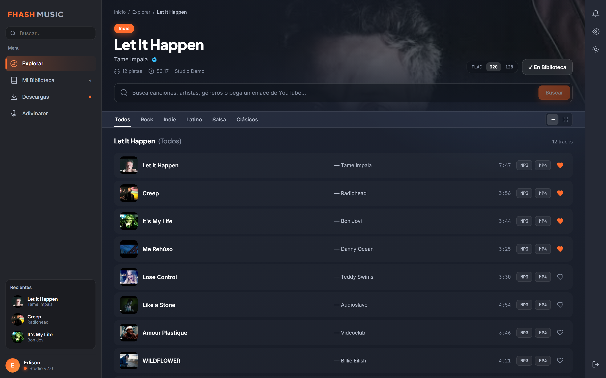
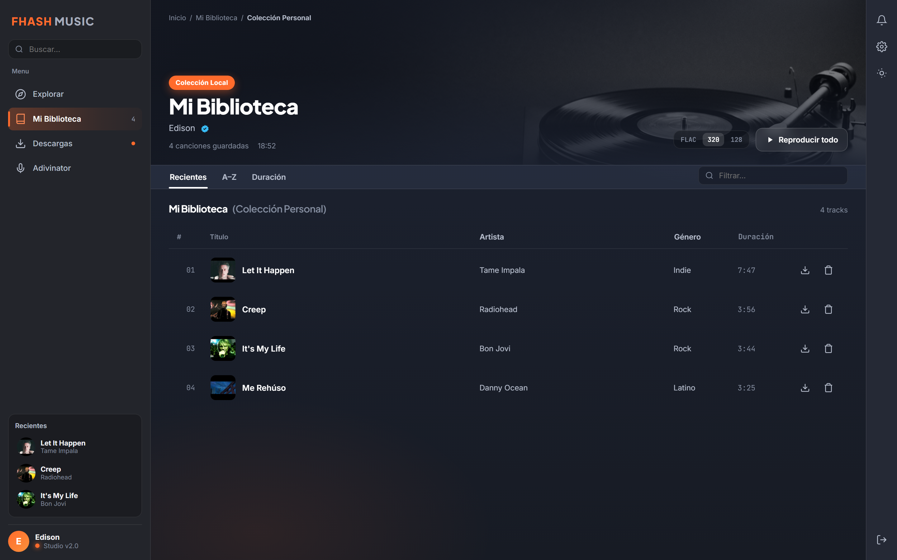
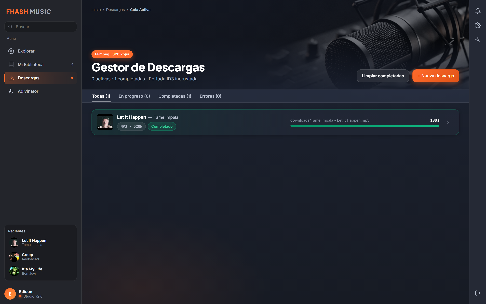
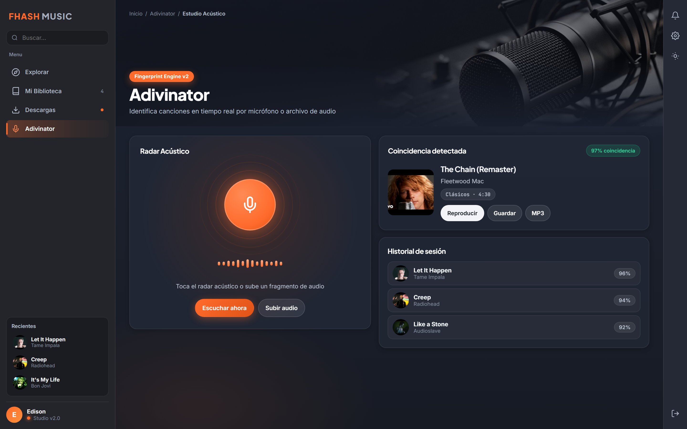

<div align="center">

# ⚡ FHASH MUSIC

**Plataforma web full-stack de descubrimiento musical, preescucha, biblioteca local y gestión de descargas**  
Construida con **Angular 21 (Standalone + Signals + OnPush)** y **FastAPI + Clean Architecture**.

[](https://angular.dev/)
[](https://fastapi.tiangolo.com/)
[](https://www.python.org/)
[](./backend/tests)
[](./LICENSE)

</div>

---

## Capturas de Pantalla

### Explorar (`/search`)
Banner horizontal dinámico de borde a borde con portada de la pista destacada, buscador instantáneo, selector de calidad (`FLAC / 320 / 128`), pestañas por género, vista editorial/cuadrícula y barra lateral con **Recientes**.



### Mi Biblioteca (`/library`)
Colección personal persistida en SQLite + `localStorage`, ordenamiento por pestañas (`Recientes`, `A–Z`, `Duración`), filtro en tiempo real y tabla editorial de pistas.



### Gestor de Descargas (`/download`)
Cola reactiva con seguimiento por etapas (`pending` → `downloading` → `converting` → `completed`), filtros por estado y extracción en **MP3 320 kbps** (con portada JPG y metadatos ID3) o **MP4** mediante `yt-dlp` y `FFmpeg`.



### Adivinator (`/recognition`)
Estudio de reconocimiento acústico con radar interactivo, visualizador de ondas en tiempo real (Web Audio API), carga de clips de audio, tarjeta de coincidencia e historial de sesión.



---

## Características Principales

- **Diseño Glassmorphism Dark Studio**: interfaz en tonos carbón mate y azul pizarra traslúcido con acento cálido `#FF6B2C`, tipografía `Plus Jakarta Sans` + `Inter` + `JetBrains Mono` e iconografía SVG uniforme.
- **Estado reactivo moderno (Angular Signals)**: stores globales (`PlayerStore`, `LibraryService`, `DownloadService`, `ToastService`) con `ChangeDetectionStrategy.OnPush` y lazy loading por feature.
- **Reproductor global persistente**: controles completos (`shuffle`, `anterior`, `play/pause`, `siguiente`, `repeat`), seek bar interactivo, volumen/mute y modo demo automático cuando el backend no está levantado.
- **Backend desacoplado (Clean Architecture)**: separación estricta en capas `domain`, `application`, `infrastructure` y `api`, con caché TTL en memoria y persistencia SQLite sin dependencias externas.
- **Calidad y CI**: 21 pruebas automatizadas (`unittest` + `FastAPI TestClient` en backend y `Vitest` en frontend) + pipeline de GitHub Actions.

---

## Arquitectura del Proyecto

```text
FhashMusic/
├── frontend/FashMusic/          # Angular 21 · Standalone · Signals · Feature-Based
│   ├── public/images/           # Banners editoriales de estudio
│   └── src/app/
│       ├── core/                # ApiService, PlayerStore, ToastService, Interceptors
│       ├── shared/              # AudioPlayer, SongCard, ToastContainer, Pipes, Directives
│       └── features/            # search, library, download, recognition (lazy-loaded)
│
├── backend/                     # FastAPI · Clean Architecture · Python 3.12
│   ├── config/                  # Settings por entorno y logging estructurado
│   ├── domain/                  # Entidades puras (Song, DownloadTask), excepciones y contratos ABC
│   ├── application/             # Casos de uso (Search, Download, Library) y DTOs Pydantic
│   ├── infrastructure/          # Adaptadores concretos (yt-dlp, FFmpeg, caché TTL, SQLite)
│   ├── api/                     # Routers REST v1 e Inyección de Dependencias
│   └── tests/                   # Suite de pruebas unitarias y de integración
│
├── docs/screenshots/            # Capturas reales de la aplicación
├── .github/workflows/ci.yml     # CI automatizado (Backend + Frontend)
├── architecture_spec.md         # Especificación técnica de arquitectura
├── CONTRIBUTING.md              # Guía de contribución y Git Flow
└── LICENSE                      # Licencia MIT
```

---

## Instalación y Uso Local

### Requisitos previos
- **Node.js** `>= 20` y **npm**
- **Python** `>= 3.11`
- **FFmpeg** instalado en el `PATH` (necesario únicamente para conversión local MP3/MP4)

### 1. Clonar el repositorio

```bash
git clone https://github.com/Edisonkz/FhashMusic.git
cd FhashMusic
```

### 2. Ejecutar el Backend (FastAPI — Puerto `9000`)

```bash
cd backend
pip install -r requirements.txt
cp .env.example .env
uvicorn main:app --reload --port 9000
```

Documentación interactiva OpenAPI / Swagger en: `http://localhost:9000/docs`

### 3. Ejecutar el Frontend (Angular — Puerto `4200`)

```bash
cd frontend/FashMusic
npm install
npm start
```

Abrir en el navegador: `http://localhost:4200`

> Si abres el frontend sin levantar el backend, la app activa automáticamente el **Modo Studio Demo** para explorar, preescuchar, gestionar biblioteca y probar la interfaz sin configuración adicional.

---

## Endpoints API v1

| Método | Endpoint | Descripción |
|--------|----------|-------------|
| `GET` | `/health` | Estado y versión del servicio |
| `GET` | `/api/v1/search/?q=...&limit=10` | Búsqueda de pistas con caché TTL en memoria |
| `POST` | `/api/v1/download/` | Encola una descarga MP3/MP4 en segundo plano (`202 Accepted`) |
| `GET` | `/api/v1/download/` | Lista el historial de descargas activas/completadas |
| `GET` | `/api/v1/download/{task_id}` | Consulta progreso y estado de una descarga |
| `GET` | `/api/v1/download/stream/{song_id}` | Redirección `307` al stream de audio para preescucha |
| `GET` | `/api/v1/library/` | Lista las canciones guardadas en SQLite |
| `POST` | `/api/v1/library/` | Guarda una canción en la biblioteca |
| `DELETE` | `/api/v1/library/{song_id}` | Elimina una canción de la biblioteca |

---

## Pruebas Automatizadas

**Backend (11 tests — unitarios + integración HTTP):**
```bash
cd backend
python -m unittest discover -s tests -v
```

**Frontend (10 specs en Vitest + build de producción):**
```bash
cd frontend/FashMusic
npm run build
npx ng test --watch=false
```

---

## Licencia y Aviso

Distribuido bajo la licencia **MIT**. Consulta el archivo [LICENSE](./LICENSE) para más detalles.

> **Aviso educativo:** Este proyecto fue desarrollado con fines de aprendizaje y portafolio técnico para demostrar patrones de Clean Architecture, diseño de interfaces reactivas con Angular Signals y APIs REST con FastAPI. Respeta siempre los términos de servicio y derechos de autor de las plataformas de contenido.

---

<div align="center">
  Desarrollado por <a href="https://github.com/Edisonkz">Edison Quispe</a>
</div>
